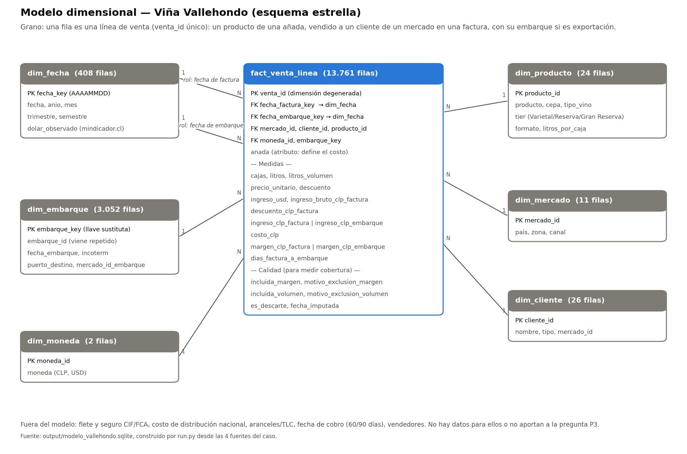

# C. Modelo dimensional

*Figura: esquema estrella construido por `run.py` en `output/modelo_vallehondo.sqlite`. Todas las cifras del informe se calculan con consultas sobre este modelo.*

## Grano

**Una fila es una línea de venta (un venta_id único): un producto de una añada, vendido a un cliente de un mercado, en una factura, con su embarque asociado si es exportación.**

La tabla de hechos tiene 13.761 filas, que son las 13.898 filas del ERP menos 137 duplicados. Cada métrica del informe es una suma de medidas de este grano, dividida por otra suma del mismo grano. Por ejemplo, el margen por litro es la suma del margen dividida por la suma de los litros. Nunca se promedian razones calculadas línea a línea.

## Hechos y dimensiones

| Tabla | Filas | Rol |
|---|---|---|
| `fact_venta_linea` | 13.761 | Cajas, litros, ingreso en USD y en CLP (con las dos fechas de conversión), descuento, costo, margen e indicadores de calidad |
| `dim_fecha` | 408 | Fecha, mes, trimestre, semestre y dólar observado del día. Cumple dos roles: fecha de factura y fecha de embarque |
| `dim_mercado` | 11 | País, zona y canal (Nacional o Exportación) |
| `dim_producto` | 24 | Producto, cepa, tipo de vino, tier, formato y litros por caja |
| `dim_cliente` | 26 | Distribuidor o importador y su mercado |
| `dim_embarque` | 3.052 | Embarque, fecha, incoterm y puerto de destino |
| `dim_moneda` | 2 | CLP y USD |

## Decisiones de diseño

**1. El grano es la línea de venta, no el embarque ni un agregado mensual.**
- El costo depende del producto y de la **añada de cada línea**. El correo dice: "el costo de una venta es el de la añada que viene en esa misma línea". Con un grano más grueso, como mercado-mes, habría que promediar costos de añadas distintas, que es justamente lo que la contraparte pidió no hacer.
- Un embarque mezcla varias ventas, y en el ~63 % de los vínculos su `mercado_id` no coincide con el de la venta. Si se usara el embarque como grano, el margen quedaría asignado a un mercado equivocado.
- No existe un grano más fino útil: el ERP no registra botellas individuales ni lotes.

**2. La fecha es una sola dimensión que cumple dos roles.**
El hecho tiene dos llaves hacia `dim_fecha`: `fecha_factura_key` y `fecha_embarque_key`. El dólar observado vive en esa dimensión. Por eso el modelo puede calcular el margen con cualquiera de las dos definiciones de conversión sin duplicar tablas, que es justo lo que pide la ficha de la métrica (componente D).

**3. La añada queda como atributo del hecho y no como dimensión.**
La añada solo sirve para tomar el costo correcto, y ese costo ya está calculado en `costo_clp`. Una dimensión aparte no agregaría atributos para analizar.

**4. Los embarques tienen una llave sustituta.**
En el JSON hay 15 `embarque_id` repetidos con fechas y puertos distintos. Por eso `dim_embarque` usa `embarque_key` y no el identificador de origen.

**5. Corea del Sur se asigna a la zona Asia.**
En la tabla de mercados, Corea del Sur trae `zona_id = 8`, que no existe en la tabla de zonas. Se asigna a Asia: así lo indican su vendedor (Export Asia) y el texto de zona en el 93 % de sus ventas.

**6. La calidad de los datos se guarda en el modelo.**
Cada fila conserva `incluida_margen`, `incluida_volumen` y el motivo de exclusión. Así, la cifra de cobertura sale de una consulta al mismo modelo y no de un cálculo aparte.

## Qué resuelve el modelo y qué no

- **Lo que resuelve:** margen y volumen por mercado, período, tier y cepa. También el margen con el dólar a la fecha de factura o a la fecha de embarque, y la conversión de cajas a litros por formato.
- **Lo que no resuelve:** el margen puesto en destino. Ni el precio ni el costo incluyen el flete. En CIF el flete lo paga la viña, pero no hay un monto por mercado ni por puerto, y la contraparte confirmó que no enviará una base de fletes.

## Qué quedó fuera y por qué

| Elemento | Motivo |
|---|---|
| Flete y seguro (CIF, FCA) y costo de distribución nacional | No están en los datos y la contraparte no los enviará. El margen se calcula antes de flete |
| Aranceles o TLC | Todos los mercados del caso tienen TLC con Chile, así que el dato no distingue entre mercados |
| Fecha de cobro (60/90 días) | Es una regla verbal, sin registro por venta. Corresponde a la pregunta P4, que está fuera del alcance |
| Vendedores | Cada zona tiene un solo vendedor, por lo que no agregan información para responder P3 |
| Columna `mes` y texto `zona` de la tabla ventas | No son confiables: `mes` no coincide con la fecha en 882 filas. Se reemplazan por `dim_fecha` y `dim_mercado` |
